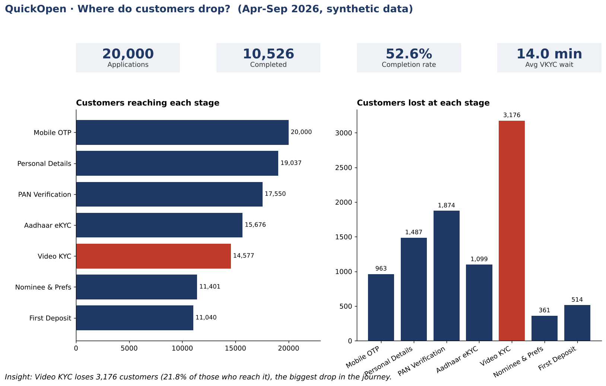
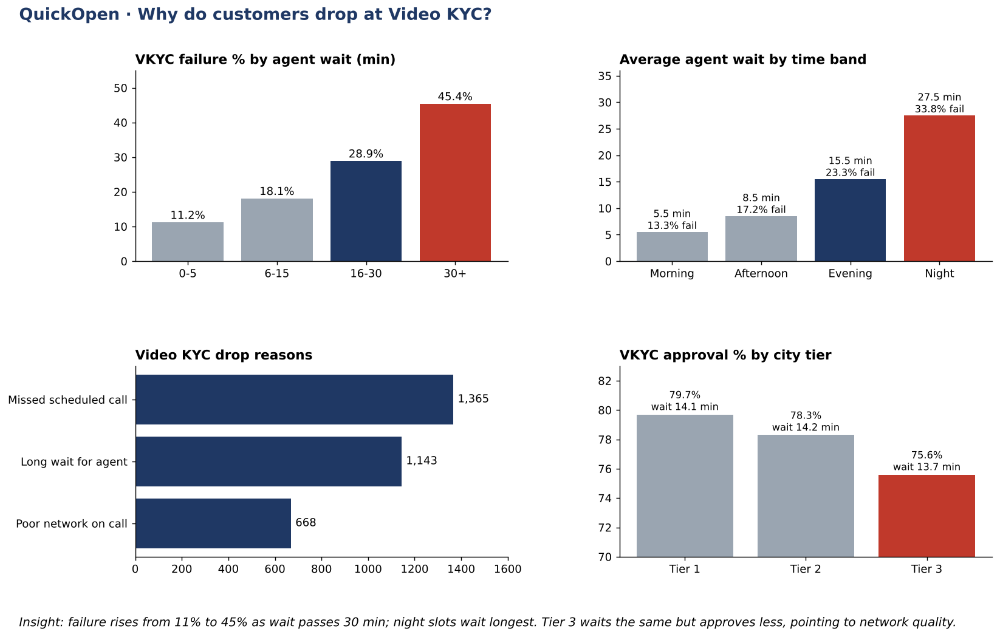

# 04_powerbi

Two-page dashboard design for managers.

| Page | Question it answers | Visuals |
| --- | --- | --- |
| 1. Funnel overview | Where do customers drop? | 4 KPI cards (applications, completed, completion %, avg VKYC wait), stage funnel, customers lost per stage, slicers for channel and city tier |
| 2. Root cause | Why do they drop at Video KYC? | Fail % by wait bucket, avg wait by time band, VKYC drop reasons, approval % by city tier |

- [`DAX_measures.md`](DAX_measures.md): every measure and calculated column, with expected values
- [`screenshots/`](screenshots): preview of both pages

> The previews are rendered from the same data and match the Excel and SQL results. The `.pbix` file will be added to this folder once it is built in Power BI Desktop using the measures above.
