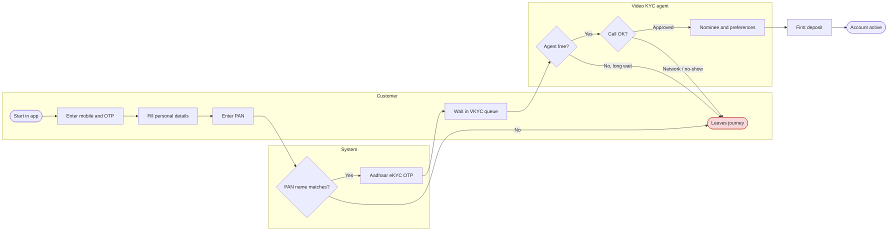
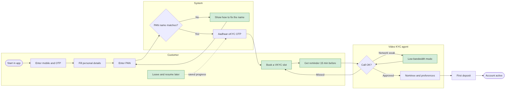

# 3. Process flows

Mermaid sources: [`as_is.mmd`](as_is.mmd), [`to_be.mmd`](to_be.mmd). Can also be redrawn in Draw.io.

## AS-IS (today)

Customers who fail the PAN name check, wait too long for an agent, miss the call or have a weak network leave the journey and must start again.

## TO-BE (proposed)

New steps in green: guidance on PAN name mismatch, Video KYC slot booking, a reminder before the call, rebooking a missed call, a low-bandwidth call mode, and save-and-resume.

