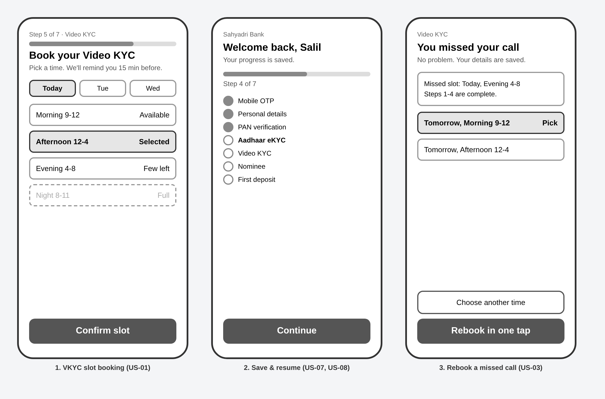

# 06_design

- [`wireframes.png`](wireframes.png): low-fidelity wireframes for slot booking (US-01), save and resume (US-07, US-08) and one-tap rebooking (US-03)
- [`jira_backlog.csv`](jira_backlog.csv): 2 epics and 10 stories with priority, story points and sprint, ready to import into JIRA (Sprint 1 = the 4 Must-haves)

