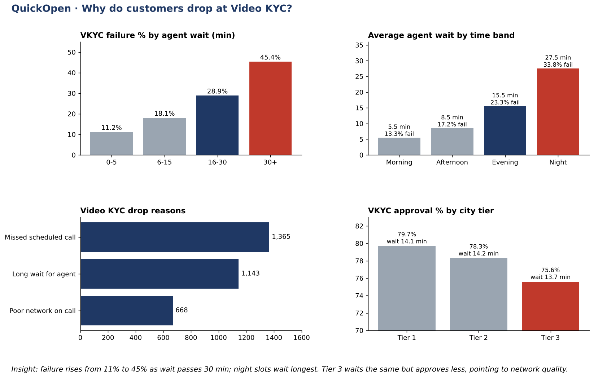

# QuickOpen: Digital Account Onboarding BA Case Study

> Business Analysis case study on **synthetic data**. Sahyadri Bank is a fictional bank.

## Business problem

Sahyadri Bank lets customers open a zero-balance savings account fully online. Many customers start but don't finish. As a Business Analyst, the goal was to find **where** and **why** customers drop off, and to define a requirement-backed solution that raises the completion rate.

## Key findings

1. Only **52.6%** of 20,000 customers completed account opening.
2. **Video KYC** is the biggest drop point: **3,176** of the 14,577 customers who reached it (**21.8%**) did not pass.
3. Video KYC failure rises from **11.2%** (0-5 min wait) to **45.4%** (30+ min wait).
4. Night slots have the longest wait (**27.5 min** average) and the highest failure (**33.8%**).
5. Tier 3 cities complete **48.8%** vs **54.3%** in Tier 1. Their Video KYC wait is the same (~14 min), so network quality is the likely driver.

## Proposed solution

| Priority | Solution |
| --- | --- |
| Must | Video KYC slot booking · reminder 15 min before the call · one-tap rebooking of missed calls |
| Should | Save and resume · progress bar · ops dashboard of booked slots |
| Could | Low-bandwidth Video KYC for weak networks · PAN name-mismatch guidance |

**Expected impact:** about **700 extra accounts every 6 months**, raising completion from **52.6% to about 56%** from slot booking alone ([estimate and assumptions](05_ba_docs/10_ROI_estimate.md)).

## What's in this repo

| Folder | Contents |
| --- | --- |
| [`01_data`](01_data) | Raw data (with deliberate quality issues), cleaned data, data dictionary |
| [`02_excel`](02_excel) | Excel workbook: cleaning log, funnel, analysis tables and charts, all formula-driven |
| [`03_sql`](03_sql) | PostgreSQL schema, load script, 11 business queries and their results |
| [`04_powerbi`](04_powerbi) | 2-page dashboard design, DAX measures and page previews |
| [`05_ba_docs`](05_ba_docs) | Problem statement, RACI, AS-IS / TO-BE flows, 5 Whys, gap analysis, MoSCoW, **BRD**, user stories, RTM, UAT cases, ROI |
| [`06_design`](06_design) | Wireframes and an importable JIRA backlog |

## Approach

1. **Discover:** problem statement, SMART goal, stakeholders and RACI
2. **Clean:** removed 150 duplicates, fixed 500 inconsistent channel values and 180 blank city tiers in Excel
3. **Analyse:** 7-stage funnel and root-cause analysis in Excel and SQL; Excel and SQL results match
4. **Visualise:** 2-page dashboard (funnel overview, root cause)
5. **Define:** AS-IS / TO-BE flows, 5 Whys, gap analysis, MoSCoW
6. **Document:** BRD, 10 user stories with acceptance criteria, RTM, UAT test cases, wireframes, JIRA backlog
7. **Measure:** impact estimate and success KPIs

## Tools

Excel · PostgreSQL · Power BI (DAX) · Mermaid / Draw.io · JIRA · Figma-style wireframes

## Author

Salil Gokhale · [LinkedIn](https://www.linkedin.com/in/salil-gokhale-analytics) · [GitHub](https://github.com/Salil360-cyber)
